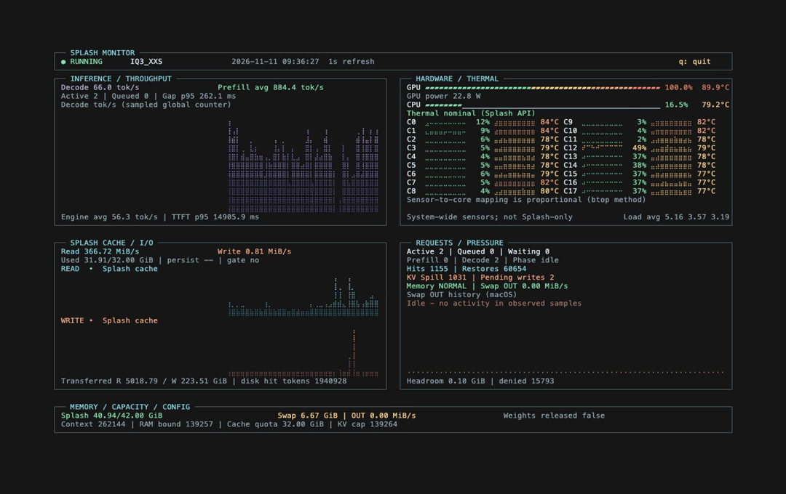

# Splash Monitor

<p align="center"></p>

<p align="center"><b>Terminal monitor for Splash inference on macOS: throughput, cache I/O, and per-core CPU temperatures in one Rust binary.</b></p>

<p align="center">
  <a href="https://github.com/cheton/splash-monitor/actions/workflows/ci.yml"></a>
  
  
  
</p>

## What you see

- Inference throughput and request phases: decode tokens/s, prefill rate, TTFT and decode gap percentiles.
- Splash cache read/write MiB/s from server counters, with in-session history graphs.
- Per-core CPU utilization and die temperatures.
- GPU utilization, power and thermal state.
- macOS swap rates, swap usage, memory pressure and free memory percentage.

## Install

```text
git clone https://github.com/cheton/splash-monitor.git
cd splash-monitor
cargo build --release
./target/release/splash-monitor
```

The binary is self-contained: no external tools, no sensor helper, no daemon and no sudo.

## Requirements

| | Requirement |
|:--|:--|
| **Run** | macOS on Apple Silicon, a reachable Splash `GET /status` endpoint |
| **Build** | Rust 1.85+, Apple Command Line Tools |

The machine that runs the binary needs no Rust toolchain.

## Options

| Option | Purpose |
|:--|:--|
| `-i, --interval SECONDS` | Refresh interval, default 5, minimum 1 |
| `-u, --url BASE_URL` | Splash base URL, default `http://127.0.0.1:18000` |
| `--api-key KEY` | Bearer token, when the server was started with `--api-key` or `SPLASH_API_KEY` |
| `-l, --log FILE` | Append one row per frame to a CSV file |
| `--cache-dir PATH` | Optional device-level I/O diagnostics for the volume holding `PATH` |
| `--no-sensors` | Do not query hardware sensors |
| `--once` | Render one frame, then exit (works in a pipe) |
| `--no-color` | Disable colors |
| `--theme MODE` | Palette used for colors: `auto` (default), `dark`, `light` |
| `--debug-sensors` | Print macOS sensor diagnostics to stderr, then exit |
| `--json` | Print one telemetry JSON sample to stdout, then exit |
| `--fixtures PATH` | Read system telemetry from a JSON fixture file |
| `-h, --help` | Show help |

| Variable | Meaning |
|:--|:--|
| `SPLASH_URL` | Full base URL, same form as `--url` |
| `SPLASH_HOST` | Host only, default `127.0.0.1` |
| `SPLASH_PORT` | Port only, default `18000` |
| `SPLASH_API_KEY` | Bearer token, same form as `--api-key` |
| `SPLASH_CACHE_DIR` | Default path for `--cache-dir` |
| `SPLASH_THEME` | Default palette: `auto`, `dark`, `light` |

Precedence: `--url` > `SPLASH_URL` > `SPLASH_HOST` / `SPLASH_PORT` > default `http://127.0.0.1:18000`. `--theme` wins over `SPLASH_THEME`, and `--api-key` wins over `SPLASH_API_KEY`. A server that needs a key answers `401` to `/status`; the monitor then shows `OFFLINE`.

`auto` asks the terminal through `COLORFGBG`: a background index of 7 or 15 selects the light palette, anything else (including no hint at all) stays dark. `--no-color`, `NO_COLOR`, or `TERM=dumb` turn colors off entirely.

## Where the numbers come from

| Splash `GET /status` | Displayed as |
|:--|:--|
| `memory_plan`, `memory_actual`, `memory_governor` | Metal allocation, limit, context window, resident bound |
| `metrics.*` | Decode tokens/s, prefill tokens/s, TTFT p95, decode gap p95, token totals |
| `active_requests`, `scheduler` | Request phases and queue depth |
| `disk.*`, `cache`, `kv_spill`, `thermal_state` | Cache capacity and I/O, hits, restores, KV spill, thermal class |

| macOS source | Reading |
|:--|:--|
| Mach `host_processor_info` ticks | Aggregate and per-core CPU utilization |
| IOHID `PMU tdie` services | CPU die temperatures |
| AppleSMC `Tg*` keys | GPU temperature |
| IOReport `GPU Stats`, `Energy Model` | GPU utilization and power |
| `host_statistics64`, `sysctl vm.swapusage`, `kern.memorystatus_vm_pressure_level` | Swap counters, swap usage, pressure, free percent |

## CPU core temperatures

Values come from IOHID `PMU tdie` sensors, which are fewer than logical cores: 14 sensors against 18 cores on an M5 Pro.
Each core row reads the sensor at `core * sensor_count / core_count`, so this mapping is this project's own and is approximate. btop++ instead prints one row per sensor index.
Unavailable sensors render `--`, never `0°C`.

## Cache and disk

Splash reports cache bytes but not its path; the engine keeps the cache as temp files under the per-user `$TMPDIR` (`splash-cache-*`, about 26 GB on the reference machine) unless persistence is enabled. `--cache-dir` therefore monitors the whole volume that hosts the given path and is labeled device-wide.

## Logging

`--log FILE` writes this header once, then one row per frame:

```text
timestamp,metal_current_GiB,metal_peak_GiB,metal_limit_GiB,pressure,free_percent,swap_used_GiB,swap_in_MiB_s,swap_out_MiB_s,active_requests,kv_spilled_pages,kv_spilled_GiB,weights_released
```

## Development

```text
cargo test
cargo run -- --debug-sensors
cargo run -- --once --no-sensors
```

## License

Apache-2.0, see [LICENSE](LICENSE). Copyright 2026 cheton.

Sensor code is derived from [btop++](https://github.com/aristocratos/btop) (Apache-2.0, Copyright 2021 Aristocratos), rewritten in Rust for this project. The four derived files carry their own attribution and change notice in their file header.
