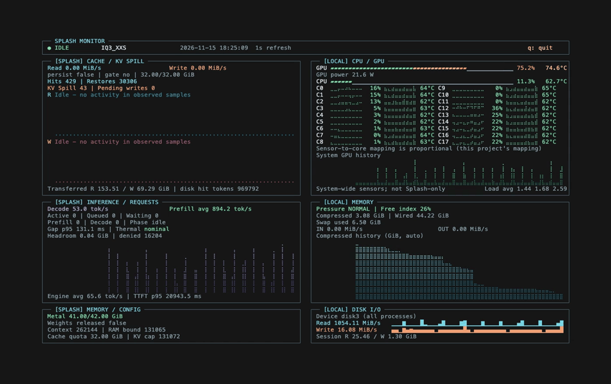

# Splash Monitor

<p align="center"></p>

<p align="center"><b>Terminal monitor for Splash inference on macOS: throughput, cache I/O, and per-core CPU temperatures in one Rust binary.</b></p>

<p align="center">
  <a href="https://github.com/cheton/splash-monitor/actions/workflows/ci.yml"></a>
  
  
  
</p>

## What you see

- Inference throughput and request phases: decode tokens/s, prefill rate, TTFT and decode gap percentiles.
- Splash cache read/write MiB/s from server counters, with in-session history graphs.
- Per-core CPU utilization and die temperatures when the terminal has room; otherwise, a sensor summary.
- GPU utilization and power, plus the Splash thermal state.
- macOS memory pressure, free index, compressed and wired memory, and swap usage and rates.
- Whole-device disk I/O for the configured cache volume.

## Install

```text
git clone https://github.com/cheton/splash-monitor.git
cd splash-monitor
cargo build --release
./target/release/splash-monitor
```

The binary is self-contained: no external tools, no sensor helper, no daemon and no sudo.

## Requirements

| | Requirement |
|:--|:--|
| **Run** | macOS on Apple Silicon, a reachable Splash `GET /status` endpoint |
| **Build** | Rust 1.85+, Apple Command Line Tools |

The machine that runs the binary needs no Rust toolchain.

## Options

| Option | Purpose |
|:--|:--|
| `-i, --interval SECONDS` | Refresh interval, default 5, minimum 1 |
| `-u, --url BASE_URL` | Splash base URL, default `http://127.0.0.1:18000` |
| `--api-key KEY` | Bearer token, when the server was started with `--api-key` or `SPLASH_API_KEY` |
| `--gateway URL` | oMLX gateway base URL; when `/status` fails, read `{gateway}/admin/api/stats` instead |
| `--gateway-key KEY` | Gateway Bearer token (`auth.api_key` in `~/.omlx/settings.json`) |
| `-l, --log FILE` | Append one row per frame to a CSV file |
| `--cache-dir PATH` | Select the local device to monitor for disk I/O using `PATH`, default `$TMPDIR` |
| `--no-sensors` | Do not query hardware sensors |
| `--once` | Render one frame, then exit (works in a pipe) |
| `--no-color` | Disable colors |
| `--theme MODE` | Palette used for colors: `auto` (default), `dark`, `light` |
| `--debug-sensors` | Print macOS sensor diagnostics to stderr, then exit |
| `--json` | Print one telemetry JSON sample to stdout, then exit |
| `--fixtures PATH` | Read system telemetry from a JSON fixture file |
| `-h, --help` | Show help |

| Variable | Meaning |
|:--|:--|
| `SPLASH_URL` | Full base URL, same form as `--url` |
| `SPLASH_HOST` | Host only, default `127.0.0.1` |
| `SPLASH_PORT` | Port only, default `18000` |
| `SPLASH_API_KEY` | Bearer token, same form as `--api-key` |
| `SPLASH_GATEWAY_URL` | Full gateway base URL, same form as `--gateway` |
| `SPLASH_GATEWAY_API_KEY` | Gateway Bearer token, same form as `--gateway-key` |
| `SPLASH_CACHE_DIR` | Cache path to measure, overrides the `$TMPDIR` default |
| `SPLASH_THEME` | Default palette: `auto`, `dark`, `light` |

Precedence: `--url` > `SPLASH_URL` > `SPLASH_HOST` / `SPLASH_PORT` > default `http://127.0.0.1:18000`. `--theme` wins over `SPLASH_THEME`, and `--api-key` wins over `SPLASH_API_KEY`. A server that needs a key answers `401` to `/status`; the monitor then shows `OFFLINE`.

`auto` asks the terminal through `COLORFGBG`: a background index of 7 or 15 selects the light palette, anything else (including no hint at all) stays dark. `--no-color`, `NO_COLOR`, or `TERM=dumb` turn colors off entirely.

## Gateway fallback (oMLX)

oMLX starts the Splash engine with a random per-run key that it never shares,
so a machine managed by oMLX answers `401` on `/status`. When `--gateway` (or
`SPLASH_GATEWAY_URL`) is set and `/status` fails, the monitor instead reads
`GET {gateway}/admin/api/stats` with `--gateway-key` / `SPLASH_GATEWAY_API_KEY`
— the same payload oMLX's own web console renders. The header then shows
`GATEWAY`. A key without a URL enables the fallback at the default gateway
`http://127.0.0.1:8000`.

The gateway counters cover throughput, request counts, cache hits, restores,
cache disk usage and memory totals. Engine-only fields stay `--` in gateway
mode: transferred cache bytes, KV spill, TTFT p95, decode gap p95, cache
persistence and gate, context bounds.

## Where the numbers come from

Panel titles identify the source: `[SPLASH]` readings come from the configured
`/status` endpoint; `[GATEWAY]` readings come from the oMLX gateway fallback;
`[LOCAL]` readings come from the Mac running the monitor, including when
accessed through SSH. These labels do not indicate whether the server is
physically remote.

| Splash `GET /status` | Displayed as |
|:--|:--|
| `memory_plan`, `memory_actual`, `memory_governor` | Metal allocation, limit, context window, resident bound |
| `metrics.*` | Decode tokens/s, prefill tokens/s, TTFT p95, decode gap p95, token totals |
| `active_requests`, `scheduler` | Request phases and queue depth |
| `disk.*`, `cache`, `kv_spill`, `thermal_state` | Cache capacity and I/O, hits, restores, KV spill, thermal class |

Cache persistence and write-gate flags show `true` or `false`; missing values
show `--`.

| macOS source | Reading |
|:--|:--|
| Mach `host_processor_info` ticks | Aggregate and per-core CPU utilization |
| IOHID `PMU tdie` services | CPU die temperatures |
| AppleSMC `Tg*` keys | GPU temperature |
| IOReport `GPU Stats`, `Energy Model` | GPU utilization and power |
| `host_statistics64`, `sysctl vm.swapusage`, `kern.memorystatus_vm_pressure_level` | Compressed and wired memory, swap counters, swap usage, pressure, free index |

## Rates, zeros and waiting frames

`Swap IN/OUT`, Splash cache `Read`/`Write`, local disk `Read`/`Write`, and
decode tokens/s are differences between consecutive samples. The first frame
has no earlier sample, so these rates show `--`. Rates appear after the next
valid sample: 5 seconds after launch at the default interval, or 1 second after
at `--interval 1`. History graphs show only observed samples.

`0.00 MiB/s` is a measured zero, not a missing value. Splash cache graphs label
an all-zero history `Idle - no activity in observed samples`; local disk
sparklines show the observed rate history instead.

`Swap IN/OUT` counts pages the kernel moved to or from swap between two refreshes.
`Swap … GiB` is swap space in use right now (`sysctl vm.swapusage`). A Mac that
still holds swap from an earlier memory-pressure event but pages nothing during
your session shows a large GiB figure together with `0.00 MiB/s`. That is the
expected pair, not a failed probe.

The full layout (100 columns by 30 rows or larger) has Splash Cache, Inference,
and Memory/config panels on the left, and local CPU/GPU, Memory, and Disk I/O
panels on the right. Each pair of panels in the same row has equal height. The
top row gets two extra lines when space permits; at the minimum size it gets one
extra line so the inference history remains visible. Smaller terminals use a
compact layout without the Disk I/O panel.

`Compressed history` shows the local physical memory occupied by the compressor,
not swap traffic or Splash memory. Older samples are on the left, newer samples
on the right; the refresh interval sets the time between samples. Its vertical
scale adjusts to the observed range, so the bottom is not necessarily zero and
small changes can appear large. The current value is shown above the graph.
Wired memory is non-pageable. These local readings are not Splash memory totals.
The compact layout retains swap-usage history and shows compressed and wired
gauges when space permits.

## CPU core temperatures

Values come from IOHID `PMU tdie` sensors, which are fewer than logical cores: 14 sensors against 18 cores on an M5 Pro.
Each core row reads the sensor at `core * sensor_count / core_count`, so this mapping is this project's own and is approximate. btop++ instead prints one row per sensor index.
Unavailable sensors render `--`, never `0°C`.

## Cache and disk

Splash reports its cache traffic but not its cache path. For local device I/O,
the monitor resolves a **path on the Mac running the monitor** to a device. By
default it uses that Mac's `$TMPDIR`, so `--cache-dir` is not needed when that
is the device you want to observe. Use `--cache-dir PATH` or `SPLASH_CACHE_DIR`
to choose a path on another device. Precedence: `--cache-dir` >
`SPLASH_CACHE_DIR` > `$TMPDIR`.

`[LOCAL] DISK I/O` reports the whole device, including every process, not Splash
alone. If Splash runs on another machine, the local path does not identify its
remote cache device. For Splash's own cache traffic, use the
`[SPLASH] CACHE / KV SPILL` panel, which reads the server's counters. If the
local path cannot be resolved, the Disk I/O panel reports the failure instead
of guessing a device.

Read and write sparklines show observed rates during this session, each scaled to its own history. Session totals add observed counter changes from the first valid sample; gaps and counter resets are not included. A device change starts a new history and totals.

## Logging

`--log FILE` writes this header once, then one row per frame:

```text
timestamp,metal_current_GiB,metal_peak_GiB,metal_limit_GiB,pressure,free_percent,swap_used_GiB,swap_in_MiB_s,swap_out_MiB_s,active_requests,kv_spilled_pages,kv_spilled_GiB,weights_released
```

Unavailable CSV values are written as `--`, including KV spill pages and bytes in gateway mode. A measured zero remains `0` (or `0.000` GiB).

## Development

```text
cargo test
cargo run -- --debug-sensors
cargo run -- --once --no-sensors
```

## License

Apache-2.0, see [LICENSE](LICENSE). Copyright 2026 cheton.

Sensor code is derived from [btop++](https://github.com/aristocratos/btop) (Apache-2.0, Copyright 2021 Aristocratos), rewritten in Rust for this project. The four derived files carry their own attribution and change notice in their file header.
